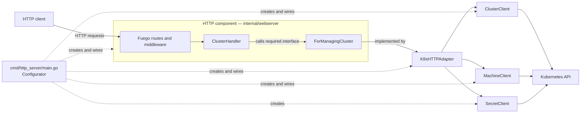

# Architecture

`go-capi-client` is an HTTP component that exposes Cluster API resources from
one Kubernetes namespace. Its design follows Alistair Cockburn's
**Component + Strategy** pattern: the HTTP subsystem declares the service it
requires and receives an implementation of that service when the process
starts.

This document describes the architecture implemented by the current code. It
also calls out places where the implementation is still only a prototype.

## Pattern and terminology

Cockburn describes a component as a bounded, replaceable unit with:

- **provided interfaces**, through which drivers use the component;
- **required interfaces**, which describe the collaborators the component
  needs;
- a **Strategy**, supplied at runtime, that satisfies a required interface;
- a **Configurator**, outside the component, that creates the objects and
  connects them.

An Adapter is a particular kind of Strategy: it translates the required
interface and delegates the work to another service. Ports & Adapters is in
turn a specialization of Component + Strategy whose boundary is placed in
front of external technologies.

The primary reference is Alistair Cockburn's
[Component-plus-Strategy generalizes Ports-and-Adapters](https://alistaircockburn.com/Component%20plus%20strategy.pdf),
Humans and Technology Technical Report 2022.01, version 3a (2023-06-01).

## Components and runtime relationships

The roles from Component + Strategy map to the code as follows:

| Pattern role | Implementation | Responsibility |
| --- | --- | --- |
| Driver | HTTP client through Fuego | Sends HTTP requests to the component |
| Provided interface | Routes registered by `HttpServer.Run` | Exposes health and cluster operations over HTTP |
| Component | `internal/webserver` | Owns transport concerns: routing, request decoding, response encoding, middleware, and OpenAPI |
| Required interface / port | `strategies.ForManagingCluster` | Defines the cluster operations needed by the HTTP component without mentioning Kubernetes types |
| Strategy and Adapter | `adapters.K8sHTTPAdapter` | Implements `ForManagingCluster`, translates between HTTP-facing models and CAPI objects, and delegates to Kubernetes clients |
| External-resource clients | `ClusterClient`, `MachineClient`, `SecretClient` | Perform namespace-scoped operations through controller-runtime's Kubernetes client |
| Configurator | `run` and `newK8sClient` in `cmd/http_server/main.go` | Select Kubernetes configuration, instantiate every collaborator, and inject the adapter into `HttpServer.Run` |

Go's implicit interface satisfaction keeps the dependency pointing towards the
HTTP component: `internal/webserver` declares `ForManagingCluster`, while
`internal/adapters` imports that package and implements it. The web server does
not import the adapter or any Kubernetes package.

## Request flow

For a typical request such as `GET /api/kubernetes/clusters/{id}`:

1. Fuego matches the route and invokes `ClusterHandler.GetCluster`.
2. The handler extracts the path parameter and calls `ForManagingCluster`.
3. The injected `K8sHTTPAdapter` calls `ClusterClient.GetCluster`.
4. `ClusterClient` queries the Kubernetes API in the configured namespace.
5. The adapter converts the CAPI `Cluster` into `strategies.ClusterInfo`.
6. Fuego serializes that transport-facing value as the HTTP response.

The same dependency path is used for create, list, delete, and kubeconfig
operations. `/ping` is self-contained in the HTTP component and does not use
the strategy.

## Package boundaries

| Path | Architectural purpose |
| --- | --- |
| `cmd/http_server/` | Executable, CLI options, runtime configuration, and object wiring |
| `internal/webserver/` | Configurable HTTP component and its required interface |
| `internal/webserver/handlers/` | HTTP entry points that delegate cluster work through the required interface |
| `internal/webserver/strategies/` | HTTP component's required contract and transport-facing data structures |
| `internal/webserver/middlewares/` | HTTP cross-cutting concerns |
| `internal/adapters/` | Production strategy that adapts the HTTP contract to Kubernetes/CAPI operations |
| `internal/kubernetes_clients/` | Concrete access to Cluster, Machine, and Secret resources |
| `charts/go-capi-client/`, `k8s/`, `Dockerfile` | Packaging and deployment; they do not contain application behavior |

## Configuration and variability

The configurator currently varies infrastructure configuration rather than the
`ForManagingCluster` implementation:

- `--kube-client=kubeconfig` builds the Kubernetes client from a local file;
- `--kube-client=in-cluster` uses the pod's ServiceAccount configuration;
- `--namespace` scopes all resource clients;
- `--swagger-ui` changes or disables the documentation UI.

Only one production Strategy, `K8sHTTPAdapter`, currently implements
`ForManagingCluster`. The component boundary nevertheless allows another
implementation or a test double to be injected without changing handlers or
routes.

## Current limitations and architectural gaps

- There are no automated tests. Cockburn treats tests at declared component
  boundaries as essential: the intended boundary should be exercised through
  HTTP with a test implementation of `ForManagingCluster`, and the production
  adapter should be tested against suitable Kubernetes test infrastructure.
- `GetClusterNodesInfo` returns deterministic mock data and does not use the
  injected `MachineClient`; node discovery is therefore not wired end to end.
- `MachineClient` is constructed even though the current adapter does not call
  it.
- Authentication middleware currently lets every request through.
- Kubernetes errors pass through without an explicit mapping to HTTP status
  codes.
- The Kubernetes resource clients are concrete collaborators of the adapter.
  If the adapter needs isolated unit tests, small required interfaces at that
  boundary would make substitutes straightforward; adding them before that
  need appears would only add indirection.
- The process has one HTTP driver and one Kubernetes-backed strategy. The
  design permits alternatives, but the configurator does not currently select
  among multiple `ForManagingCluster` implementations.

These limitations do not change the dependency direction, but they mean the
component's replaceability and isolation are design properties that still need
to be demonstrated by tests.
