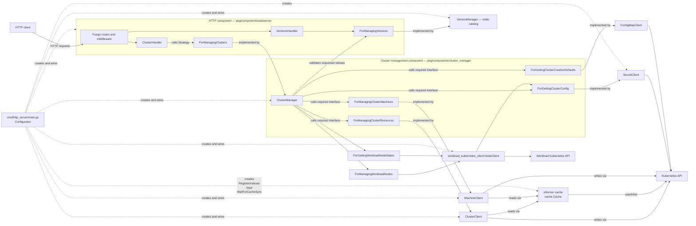

# Architecture

`go-capi-client` is an HTTP component that exposes Cluster API resources from
one Kubernetes namespace. Its design follows Alistair Cockburn's
**Component + Strategy** pattern: the HTTP subsystem declares the service it
requires and receives an implementation of that service when the process
starts.

This document describes the architecture implemented by the current code. It
also calls out places where the implementation is still only a prototype.

## Pattern and terminology

Cockburn describes a component as a bounded, replaceable unit with:

- **provided interfaces**, through which drivers use the component;
- **required interfaces**, which describe the collaborators the component
  needs;
- a **Strategy**, supplied at runtime, that satisfies a required interface;
- a **Configurator**, outside the component, that creates the objects and
  connects them.

`Component` is an architectural role, not a code identifier. Concrete types
are named after the capability they provide, following the existing
`HttpServer` convention: the cluster-management component is therefore named
`ClusterManager`. Constructors and variables follow the same vocabulary
(`NewClusterManager`, `clusterManager`).

Strategies are shared contracts declared under `pkg/strategies/`. Each
contract lives in one `for_*.go` file together with models used only by that
contract. Models shared by multiple Strategies live once in `models.go` so
compatible contracts can exchange values without duplicate representations or
pass-through conversions. Components are declared under `pkg/components/`
and may consume or implement any of these contracts. A concrete component is
injected directly when it satisfies a Strategy; an Adapter is introduced only
when translation is required.

Transport concerns remain inside the transport component. In particular, JSON
metadata and HTTP validation tags belong to DTOs under `components/webserver`;
the shared Strategy models do not contain transport-specific validation.

An Adapter is a particular kind of Strategy: it translates the required
interface and delegates the work to another service. Ports & Adapters is in
turn a specialization of Component + Strategy whose boundary is placed in
front of external technologies.

The primary reference is Alistair Cockburn's
[Component-plus-Strategy generalizes Ports-and-Adapters](https://alistaircockburn.com/Component%20plus%20strategy.pdf),
Humans and Technology Technical Report 2022.01, version 3a (2023-06-01).

## Components and runtime relationships

The roles from Component + Strategy map to the code as follows:

| Pattern role | Implementation | Responsibility |
| --- | --- | --- |
| Driver | HTTP client through Fuego | Sends HTTP requests to the component |
| Provided interface | Routes registered by `HttpServer.Run` | Exposes health, cluster operations, and available versions over HTTP |
| Component | `pkg/components/webserver` | Owns transport concerns: routing, DTO validation, encoding, middleware, and OpenAPI |
| Strategy | `strategies.ForManagingClusters` | Shared contract used by the HTTP component and implemented by `ClusterManager` |
| Provided operations | `cluster_manager.ClusterManager` methods | Expose cluster-management use cases without declaring a producer-owned Go interface |
| Component | `cluster_manager.ClusterManager` | Owns cluster-management use cases and orchestration |
| Strategy | `strategies.ForManagingVersions` | Used by the HTTP and cluster components; implemented by `VersionManager` |
| Component | `versionmanager.VersionManager` | Owns the static release catalog and exact version availability checks |
| Strategies | `ForManagingClusterResources`, `ForManagingClusterMachines`, `ForGettingClusterConfig` | Describe the capabilities required by `ClusterManager` without Kubernetes types |
| Strategies | `ClusterClient`, `MachineClient`, `SecretClient` | Implement the component's technology-independent required interfaces using Kubernetes |
| Configurator | `run` in `cmd/http_server/main.go` | Select Kubernetes configuration, build the informer cache, instantiate the Strategies and component, and inject the component into `HttpServer.Run` |

Go's implicit interface satisfaction lets `cluster_manager.ClusterManager`
satisfy `ForManagingClusters` directly. The HTTP handler converts its validated
DTOs to and from the transport-neutral Strategy models. `ClusterClient`,
`MachineClient`, and `SecretClient` likewise satisfy their Strategies directly,
so no Adapter is needed in the current graph.

### Informer cache and read/write split

`ClusterClient` and `MachineClient` separate reads from writes using a
controller-runtime `cache.Cache`:

- **Reads** (`List`, `Get`, UUID lookup, tag reads) go through the informer
  cache, which is kept current by Kubernetes watch events. UUID-based lookups
  (`GetByUUID`, `GetMachineByUUID`) use custom UUID v5 field indexes registered
  in `pkg/components/kubernetes_clients/indexers.go` before the cache starts.
- **Writes** (`Create`, `Delete`, scaling, pause, `SetTag`, `DeleteTag`) go
  through the direct `client.Client`, which always contacts the Kubernetes API.
  Cluster mutations first resolve the UUID through the informer cache, then
  fetch the current resource by its Kubernetes name. Tag mutations read a fresh
  resource version via the direct client before patching to avoid conflicts.

Both clients hold a cache for reads and a direct client for mutations, including
node deletion, replica changes, and reconciliation pause updates.
`SecretClient` uses the direct Kubernetes client to read the kubeconfig Secret.
For config requests, `ClusterManager` resolves the cluster UUID through
`ForManagingClusterResources.GetByUUID` and passes the resulting Kubernetes
resource name to `ForGettingClusterConfig`. Cluster and node API operations use
UUIDs for addressing; Kubernetes resource names remain internal lookup keys and
descriptive response fields.

The Configurator registers the UUID field indexes, starts the cache goroutine,
and blocks on `WaitForCacheSync` before serving requests, so the initial list is
complete before the first HTTP request arrives.

## Request flow

For a typical request such as `GET /kubernetes/clusters/{id}` (UUID):

1. Fuego matches the route and invokes `ClusterHandler.GetCluster`.
2. The handler parses the UUID path parameter and calls `ForManagingClusters.GetClusterByUUID`.
3. `ClusterManager` delegates to `ForManagingClusterResources.GetByUUID`.
4. `ClusterClient` issues `cache.List` with a `MatchingFields{"uuid": id}` filter against the UUID field index.
5. The informer cache resolves the index in O(1) and returns the matching `Cluster`.
6. `ClusterClient` converts it to a `ClusterInfo` Strategy model (including a stable UUID v5 `id`).
7. The handler converts it into an HTTP response DTO and Fuego serializes it.

For `GET /kubernetes/nodes/{id}` (node UUID):

1. The handler calls `ForManagingClusters.GetNodeByUUID`.
2. `ClusterManager` delegates to `ForManagingClusterMachines.GetMachineByUUID`.
3. `MachineClient` issues `cache.List` with a UUID field index filter.
4. The result is converted to a `ClusterNodeInfo` Strategy model and serialized.

For `GET /kubernetes/clusters/{id}/config` (cluster UUID):

1. The handler parses the UUID and calls `ForManagingClusters.GetClusterConfig`.
2. `ClusterManager` resolves the cluster with
  `ForManagingClusterResources.GetByUUID`.
3. `ClusterManager` passes the resolved Kubernetes resource name to
  `ForGettingClusterConfig.Get`.
4. `SecretClient` reads the `<cluster-name>-kubeconfig` Secret through the
  direct Kubernetes client.

`ClusterManager` also requires `ForManagingVersions`, implemented by `VersionManager`,
to reject unavailable versions before fetching defaults or creating resources.
The configurator injects the same version manager into the HTTP and cluster components.
`GET /kubernetes/versions-available` calls `GetAllVersions`; the handler maps
Strategy `VersionGroup` values to JSON DTOs using `lo.Map`, preserving their
newest-first order. The catalog is defined in code, not queried from Kubernetes.

The creation payload requires `kubernetes_version`, a full `major.minor.patch`
release such as `1.36.9`, without a `v` prefix. The handler maps it to
`CreateClusterParams.Version`.
`IsVersionAvailable` checks exact membership in this catalog. Missing or
unavailable versions produce HTTP 422 before defaults are read or resources
are created. `CreateClusterResourceParams.Version` carries the selected release
with the `v` prefix required by CAPI. It is used for the control plane, worker
MachineDeployment, and bootstrap command rendering. The ConfigMap no longer
provides a Kubernetes version; any legacy `kubernetesVersion` key is ignored.

For creation, `CreateClusterParams` carries the cluster name, control-plane and
worker replica counts, requested Kubernetes version, control-plane IP, and VM name prefix through
`ForManagingClusters`. `ClusterManager` enriches this intent through `ForGettingClusterCreationDefaults` with its
VM and bootstrap configuration, MachineDeployment identity, endpoint network
settings, and load-balancer choice. It then sends the resulting
`CreateClusterResourceParams` through `ForManagingClusterResources`.
Creation writes go directly through the `client.Client`; the informer cache is not involved.

The same dependency path is used for list, delete, and kubeconfig operations.
`/ping` is self-contained in the HTTP component and does not use a Strategy.

## Package boundaries

| Path | Architectural purpose |
| --- | --- |
| `cmd/http_server/` | Executable, CLI options, runtime configuration, and object wiring |
| `pkg/components/webserver/` | HTTP component, transport DTOs, handlers, middleware, and OpenAPI |
| `pkg/components/cluster_manager/` | Cluster-management use cases and orchestration |
| `pkg/components/version_manager/` | Static Kubernetes release catalog and availability checks |
| `pkg/components/management_kubernetes_client/` | Kubernetes implementations of resource Strategies; informer cache UUID  |
| `pkg/components/workload_kubernetes_client/` | Workload Node actions, observed states and dynamic client creation |
| `pkg/strategies/` | Shared contracts in `for_*.go`; cross-contract models in `models.go` |
| `pkg/uuids/` | Pure UUID v5 utilities: namespace constants and `ClusterID`/`NodeID` helpers |
| `charts/go-capi-client/`, `k8s/`, `Dockerfile` | Packaging and deployment; they do not contain application behavior |

## Workload Node operations

`ClusterManager` consumes separate `ForManagingWorkloadNodes` and
`ForGettingWorkloadNodeStates` Strategies, both implemented by
`workload_kubernetes_client.NodeClient`. The workload component consumes
`ForGettingClusterConfig`; the configurator injects the management `SecretClient`
for that contract. There is no concrete dependency between these components.

Action routes identify clusters and Machines by UUID.
`MachineClient.GetNodeName` resolves the UUIDs through the informer cache, verifies
cluster membership against a fresh Machine read and reads
`status.nodeRef.name`. Missing registration returns a domain conflict before
creating the workload connection. The workload component parses the current
Secret kubeconfig into a new typed client-go client per operation. The management
client remains bound to its original cluster throughout concurrent requests.

Cordon and uncordon use an optimistic patch of `spec.unschedulable`. Drain
cordons first, validates candidate pods, submits UID-protected `policy/v1`
evictions and polls until completion. PDB throttling is retried within a bounded,
cancellable context. Mirror and completed pods are skipped; unmanaged pods,
DaemonSets and emptyDir volumes need their corresponding request options.
An accepted drain always leaves the Node cordoned unless another actor changes it.
No operation registry, annotations or background drain tasks are maintained.

Read enrichment is best effort and lists Nodes and Pods once per cluster with a
five-second deadline. Collection enrichment runs in parallel across clusters
using `lo/parallel`, with one state read per cluster and writes to distinct result
indices to preserve response order without shared-map writes. `IsCordon` and `IsDraining` use optional booleans throughout
the Strategies and HTTP DTOs. `IsDraining` means cordoned with at least one
terminating pod, independently of which actor initiated the deletion. Node
responses join this snapshot to Machines by `status.nodeRef.name`. Cluster
responses aggregate with any-true semantics; an unknown value prevents claiming
false. Missing Machine registrations are included as unknown. Explicit false
values survive JSON serialization and field projection; unknown fields are omitted.

Workload permissions are supplied by the retrieved kubeconfig: Nodes get/list/patch,
Pods list, and pods/eviction create across namespaces. They are independent of the
management chart's namespace-scoped Role, which already permits Secret reads.

## Configuration and variability

The configurator currently varies infrastructure configuration rather than the
`ForManagingClusters` implementation:

- `--kube-client=kubeconfig` builds the Kubernetes client from a local file;
- `--kube-client=in-cluster` uses the pod's ServiceAccount configuration;
- `--namespace` scopes all resource clients;
- `--swagger-ui` changes or disables the documentation UI.

`ClusterManager` implements `ForManagingClusters` directly. Its required
Strategies allow Kubernetes clients or test implementations to be injected
without changing the component.

Cluster creation defaults are provided by the
`ForGettingClusterCreationDefaults` Strategy. The `management_kubernetes_client.ConfigMapClient`
implements this contract and reads `cluster-defaults` in the configured namespace
on every call. The ConfigMap and the keys documented in the README are required;
missing keys or decoding errors are propagated instead of being replaced by values built
into the binary. The configurator injects this client into `ClusterManager`,
keeping Kubernetes types out of the manager and shared contracts.

`ClusterManager` implements `ForManagingClusters` for the HTTP component
and requires `ForManagingClusterResources`, implemented by `ClusterClient`.
The manager owns the use cases and application error handling; the client
stores the optional description as the `vmk.vates.tech/description` annotation
on the CAPI `Cluster`, alongside tags stored as labels with the
`tags.vmk.vates.tech/` prefix. Tags can be supplied during cluster creation or changed through the
HTTP tag routes; the Kubernetes resource is the source of truth across process
restarts. Label-specific validation stays in `ClusterClient`, so another
`ForManagingClusterResources` implementation can apply the constraints of
its own storage technology.

## Current limitations and architectural gaps

- Managers, handlers, HTTP routes (`httptest`), and Kubernetes Strategies
  (fake clients) are tested. Integration tests against a live Kubernetes API
  and provider are still needed.
- `GetClusterNodesInfo` currently derives its flat node information from CAPI
  Machines. Workload-cluster Node enrichment is not wired yet, although the
  machine list already exposes the Xen Orchestra VM UUID as `node_id` when a
  valid machine `providerID` is available.
- Authentication middleware currently lets every request through.
- Application errors are mapped to HTTP status codes, including validation
  (422), missing clusters or tags (404), and existing clusters (409). Other
  failures currently return 500.
- The Kubernetes resource clients are Strategies selected by the Configurator.
  The component itself can be isolated through its declared required interfaces.
- The process has one HTTP driver and one Kubernetes-backed strategy. The
  design permits alternatives, but the configurator does not currently select
  among multiple `ForManagingClusters` implementations.

The tests demonstrate component isolation through injected Strategies. Live
cluster integration coverage remains necessary to verify provider behavior.

### Cluster creation

`ClusterClient` builds cluster resources directly from the request and the
`cluster-defaults` ConfigMap. `ClusterManager` passes network, VM and kubeadm
configuration through `ForGettingClusterCreationDefaults`. No template resources
are read from Kubernetes. The VM/bootstrap YAML blocks are decoded and checked for the expected object shape
before creation, then copied into per-cluster resources owned by the Cluster.
The Cluster stays paused during assembly and is activated after successful
creation. Partial failures can be cleaned up through the delete endpoint.
See README for configuration keys and image prerequisites.

### Node deletion

`DELETE /kubernetes/clusters/{id}/nodes/{nodeID}` invokes
`ForManagingClusters.DeleteClusterNode`. The route takes the cluster UUID and
node UUID. `ClusterManager` checks that the Cluster exists, then delegates to
`ForManagingClusterMachines.DeleteMachine`. `MachineClient` resolves the Machine
through the UUID and cluster UUID cache indexes in the configured namespace,
checks its current identity using `spec.clusterName`, and requests deletion with
UID and resource-version preconditions to protect against concurrent replacement
or reassignment. The HTTP boundary returns 204 without waiting for finalizers.
Replica counts are unchanged. HTTP routes, parameters, responses, and application
errors use node terminology. Node responses expose `id` (the stable UUID used to
address the node, a UUID v5 of the Machine name under the cluster's UUID),
`name` (the stable Kubernetes resource name), optional `node_name` (the
registered Node name from `status.nodeRef.name`), and `node_id` (the provider
VM UUID). The `name` and `node_name` fields are descriptive and are not used to
address deletion requests. Because `id` never depends on `status.nodeRef`, it is
available as soon as the Machine is created and does not change when the Node
registers; since Machine names are unique per namespace, two Machines in the
configured namespace can never share an `id`.

## Replica updates

Two independent PUT endpoints under `/kubernetes/clusters/{id}` set desired
counts: `/workers/replicas` and `/control-plane/replicas`. Both accept
`{"replicas":3}` and return an empty 204 after Kubernetes acknowledges the write.
The existing Cluster and node GET endpoints expose asynchronous convergence;
Cluster status can lag behind the accepted desired count.

Handlers validate a required `*int32`, ClusterManager validates the application
parameters, and ClusterClient resolves and patches a single target. Workers use
the cluster label plus `spec.clusterName` and require exactly one MachineDeployment.
Control planes use `spec.controlPlaneRef` and require KubeadmControlPlane v1beta2.
Existing Cluster owner references must match the current Cluster UID. The existing
unstructured control-plane representation avoids adding another API dependency.

Only `spec.replicas` changes, using an optimistic merge patch with resourceVersion.
Same-value requests skip the write. Concurrent target changes yield 409; there are
no automatic retries or cross-resource rollbacks. Read-side checks of the Cluster
and worker group membership are not atomic with the target patch.

Counts start at one; stacked-etcd control planes require odd counts, as determined
from their current kubeadm configuration. Paused/deleting resources, topology-managed
clusters, unsupported control-plane providers, missing/ambiguous targets, and worker
autoscaler annotations yield 409. Invalid counts yield 422; an absent Cluster yields
404. Infrastructure errors retain their technical causes internally and yield 500.
The namespace-scoped RBAC grants get/list/patch on MachineDeployments and get/patch
on KubeadmControlPlanes in addition to their existing create permission.

## Pause and resume CAPI reconciliation

`POST` on `/kubernetes/clusters/{id}/reconciliation/pause` and
`/kubernetes/clusters/{id}/nodes/{nodeID}/reconciliation/pause` pauses reconciliation.
`POST` on `/kubernetes/clusters/{id}/reconciliation/resume` and
`/kubernetes/clusters/{id}/nodes/{nodeID}/reconciliation/resume` resumes it. The
cluster and node path parameters are UUIDs. These routes invoke the pause setters
through ClusterHandler and ClusterManager. ClusterClient resolves the cluster
UUID before patching only `spec.paused`; MachineClient resolves the node through
the UUID cache indexes and patches only `cluster.x-k8s.io/paused`, after checking
membership with `spec.clusterName`. Patches include an optimistic resourceVersion
lock; conflicts are exposed as HTTP 409. The configured namespace scopes both
operations.

The `Paused` field in the shared models and `is_reconciliation_paused` in HTTP DTOs report each resource's
configured pause independently. Resuming a cluster does not remove individual
Machine annotations, and resuming a Machine does not change the cluster spec.
Existing cluster deletion still clears spec pause after requesting deletion.
