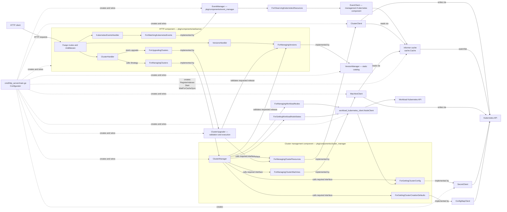

# Architecture

`go-capi-client` is an HTTP component that exposes Cluster API resources from
one Kubernetes namespace. Its design follows Alistair Cockburn's
**Component + Strategy** pattern: the HTTP subsystem declares the service it
requires and receives an implementation of that service when the process
starts.

This document describes the architecture implemented by the current code. It
also calls out places where the implementation is still only a prototype.

## Pattern and terminology

Cockburn describes a component as a bounded, replaceable unit with:

- **provided interfaces**, through which drivers use the component;
- **required interfaces**, which describe the collaborators the component
  needs;
- a **Strategy**, supplied at runtime, that satisfies a required interface;
- a **Configurator**, outside the component, that creates the objects and
  connects them.

`Component` is an architectural role, not a code identifier. Concrete types
are named after the capability they provide, following the existing
`HttpServer` convention: the cluster-management component is therefore named
`ClusterManager`. Constructors and variables follow the same vocabulary
(`NewClusterManager`, `clusterManager`).

Strategies are shared contracts declared under `pkg/strategies/`. Each
contract lives in one `for_*.go` file together with models used only by that
contract. Models shared by multiple Strategies live once in `models.go` so
compatible contracts can exchange values without duplicate representations or
pass-through conversions. Components are declared under `pkg/components/`
and may consume or implement any of these contracts. A concrete component is
injected directly when it satisfies a Strategy; an Adapter is introduced only
when translation is required.

Transport concerns remain inside the transport component. In particular, JSON
metadata and HTTP validation tags belong to DTOs under `components/webserver`;
the shared Strategy models do not contain transport-specific validation.

The event component under `pkg/components/event_manager` owns global Kubernetes
event subscriptions. `EventManager` implements `ForWatchingKubernetesEvents`
and consumes `ForObservingKubernetesResources`, implemented by the management
component's `EventClient`. The configurator starts one shared observer using the
existing namespace-scoped informer cache for Cluster, Machine and Secret
resources. Initial lists seed internal state without notifications, deletion
tombstones retain identity, and Secret observations expose only kubeconfig availability, never Secret data.
The adapter has separate typed observers and projections for Cluster, Machine
and kubeconfig Secret resources. Shared code handles informer registration,
namespace filtering, initial lists, tombstones and cleanup; resource-specific
rules live in separate functions within `events.go`. Initial synchronization
is bounded to 30 seconds per informer; a timeout rolls back registered observers
and aborts startup. After successful synchronization, the timeout does not limit
the lifetime of the observer.

Cluster and Secret callbacks join through a mutex-protected identity/availability
state. A Secret observed before its Cluster is retained as metadata and a boolean,
then reconsidered when the Cluster arrives. Initial lists seed the baseline
without announcing existing availability. A Secret with a Cluster owner UID
must match the current Cluster identity. Deletion drops the linked identity so
late Secret callbacks cannot recreate it. Kubeconfig events carry only identity
and availability, never mutable Cluster snapshots read from a faster cache.
This avoids rolling Cluster state backward across independently ordered informers.

`EventManager` routes observations to dedicated Cluster, Machine and kubeconfig
transition functions in `event_manager.go`. Helpers return complete events,
including tag/upgrade context. Scaling tracking is updated directly by the
scaling transition function and cleared on Cluster deletion or replacement;
tracking never depends on parsing emitted event names.

`EventManager` derives business transitions and maintains independent bounded
queues of 128 events. A slow subscriber is disconnected on overflow rather
than blocking informer callbacks or losing events silently. Each subscription
also produces a heartbeat every five seconds. Cancellation closes the channel,
including when a delivery is pending. Contracts use transport-independent Go
models without HTTP or Kubernetes types.

Scaling is based on the Cluster's current-generation `ScalingUp`/`ScalingDown`
conditions and aggregate replica convergence. The manager retains pending
completion across unknown conditions and lagging counters. Upgrade transitions
come from the existing persisted operation and never infer success from a
missing lock or annotation. The HTTP component projects shared Cluster/node
models into existing public DTOs and explicit event context fields.

The scaling signal is known only when the CAPI conditions have the Cluster's
current `observedGeneration` and a True/False status. Either `ScalingUp` or
`ScalingDown` being true confirms activity; both must be known false to confirm
its end. Completion additionally requires positive desired counts and total,
ready and available replicas equal to the targets for both control plane and
workers. The manager retains a previously observed active scaling across unknown
conditions or lagging counters until completion. Deletion clears this tracking
without announcing success. `is_scaling` reflects the current CAPI signal;
it does not include this retained completion tracking.

Scaling contexts use `group: "cluster"` with `control_plane_status` and
`worker_status`; there is no separate tracked operation per MachineDeployment.
A difference between desired and ready replicas alone does not start an event
sequence. Initial provisioning may also publish a CAPI scaling signal.

Upgrade transitions follow `vmk.vates.tech/upgrade`, written by the upgrade
component. A new or reactivated locked operation starts the sequence; changes to
replica counters or version distributions report progress. Completion requires
the same operation ID, a previously held lock, its release and a nonempty
`completed_at`. Missing or malformed operation annotations, mixed versions or
a missing lock alone never imply success. External version changes without a
persisted operation are not tracked upgrades. Upgrade contexts contain only
`operation_id`, `target_version` and aggregate replica statuses, excluding
internal diagnostics. `is_upgrading` and `is_scaling` are independent and may
both be true. Reconciliation pause does not announce operation success.

The webserver uses the `EventContext` interface with concrete tag, description,
kubeconfig, scaling and upgrade context structs. This keeps JSON field types
explicit while the event manager's shared models remain transport-independent.
See the [SSE catalogue and examples](README.md#event-catalogue) for the public
contract and manual verification commands.

The HTTP component's `KubernetesEventsHandler` exposes `/kubernetes/events`,
consumes this Strategy and owns SSE headers, JSON DTOs, frame encoding and
flushing. It cancels its subscription
on client disconnection or write failure. The absolute HTTP write timeout is
disabled for long-lived streams, with separate ten-second deadlines for each
header/frame write and flush. Deadlines are cleared between frames. The SSE
route uses the original response writer, bypassing Fuego's access-log wrapper
which does not expose write-deadline support; authentication still applies.
The frontend must reload REST state after
reconnection because this stream has neither replay nor event IDs.

An Adapter is a particular kind of Strategy: it translates the required
interface and delegates the work to another service. Ports & Adapters is in
turn a specialization of Component + Strategy whose boundary is placed in
front of external technologies.

The primary reference is Alistair Cockburn's
[Component-plus-Strategy generalizes Ports-and-Adapters](https://alistaircockburn.com/Component%20plus%20strategy.pdf),
Humans and Technology Technical Report 2022.01, version 3a (2023-06-01).

## Components and runtime relationships

The roles from Component + Strategy map to the code as follows:

| Pattern role | Implementation | Responsibility |
| --- | --- | --- |
| Driver | HTTP client through Fuego | Sends HTTP requests to the component |
| Provided interface | Routes registered by `HttpServer.Run` | Exposes health, cluster operations, and available versions over HTTP |
| Component | `pkg/components/webserver` | Owns transport concerns: routing, DTO validation, encoding, middleware, and OpenAPI |
| Strategy | `strategies.ForManagingClusters` | Shared contract used by the HTTP component and implemented by `ClusterManager` |
| Provided operations | `cluster_manager.ClusterManager` methods | Expose cluster-management use cases without declaring a producer-owned Go interface |
| Component | `cluster_manager.ClusterManager` | Owns cluster-management use cases and orchestration |
| Strategy | `strategies.ForUpgradingClusters` | Starts or resumes upgrades by cluster UUID and requested version |
| Component | `cluster_upgrader.ClusterUpgrader` | Owns upgrade validation, planning, execution, persistence, locks, recovery and goroutine lifecycle |
| Strategy | `strategies.ForManagingVersions` | Used by the HTTP, cluster-management and upgrade components; implemented by `VersionManager` |
| Component | `versionmanager.VersionManager` | Owns the static release catalog and exact version availability checks |
| Strategies | `ForManagingClusterResources`, `ForManagingClusterMachines`, `ForGettingClusterConfig` | Describe the capabilities required by `ClusterManager` without Kubernetes types |
| Strategies | `ClusterClient`, `MachineClient`, `SecretClient` | Implement the component's technology-independent required interfaces using Kubernetes |
| Configurator | `run` in `cmd/http_server/main.go` | Select Kubernetes configuration, build the informer cache, instantiate the Strategies and component, and inject the component into `HttpServer.Run` |
| Component | `eventmanager.EventManager` | Derives business transitions and fans them out alongside per-subscriber heartbeats |
| Strategy | `ForObservingKubernetesResources` | Supplies immutable resource snapshots and change notifications |
| Component implementation | `management_kubernetes_client.EventClient` | Observes shared informers and projects resource changes into Strategy models |

Go's implicit interface satisfaction lets `cluster_manager.ClusterManager`
satisfy `ForManagingClusters` directly. The HTTP handler converts its validated
DTOs to and from the transport-neutral Strategy models. `ClusterClient`,
`MachineClient`, and `SecretClient` likewise satisfy their Strategies directly,
so no Adapter is needed in the current graph.

### Informer cache and read/write split

`ClusterClient` and `MachineClient` separate reads from writes using a
controller-runtime `cache.Cache`:

- **Reads** (`List`, `Get`, UUID lookup, tag reads) go through the informer
  cache, which is kept current by Kubernetes watch events. UUID-based lookups
  (`GetByUUID`, `GetMachineByUUID`) use custom UUID v5 field indexes registered
  in `pkg/components/management_kubernetes_client/indexers.go` before the cache starts.
- **Writes** (`Create`, `Delete`, scaling, pause, `SetTag`, `DeleteTag`) go
  through the direct `client.Client`, which always contacts the Kubernetes API.
  Cluster mutations first resolve the UUID through the informer cache, then
  fetch the current resource by its Kubernetes name. Tag mutations read a fresh
  resource version via the direct client before patching to avoid conflicts.

Both clients hold a cache for reads and a direct client for mutations, including
node deletion, replica changes, and reconciliation pause updates.
`SecretClient` uses the direct Kubernetes client to read the kubeconfig Secret.
For config requests, `ClusterManager` resolves the cluster UUID through
`ForManagingClusterResources.GetByUUID` and passes the resulting Kubernetes
resource name to `ForGettingClusterConfig`. Cluster and node API operations use
UUIDs for addressing; Kubernetes resource names remain internal lookup keys and
descriptive response fields.

The Configurator registers the UUID field indexes, starts the cache goroutine,
and blocks on `WaitForCacheSync` before serving requests, so the initial list is
complete before the first HTTP request arrives.

## Request flow

For a typical request such as `GET /kubernetes/clusters/{id}` (UUID):

1. Fuego matches the route and invokes `ClusterHandler.GetCluster`.
2. The handler parses the UUID path parameter and calls `ForManagingClusters.GetClusterByUUID`.
3. `ClusterManager` delegates to `ForManagingClusterResources.GetByUUID`.
4. `ClusterClient` issues `cache.List` with a `MatchingFields{"uuid": id}` filter against the UUID field index.
5. The informer cache resolves the index in O(1) and returns the matching `Cluster`.
6. `ClusterClient` converts it to a `ClusterInfo` Strategy model (including a stable UUID v5 `id`).
7. The handler converts it into an HTTP response DTO and Fuego serializes it.

For `GET /kubernetes/nodes/{id}` (node UUID):

1. The handler calls `ForManagingClusters.GetNodeByUUID`.
2. `ClusterManager` delegates to `ForManagingClusterMachines.GetMachineByUUID`.
3. `MachineClient` issues `cache.List` with a UUID field index filter.
4. The result is converted to a `ClusterNodeInfo` Strategy model and serialized.

For `GET /kubernetes/clusters/{id}/config` (cluster UUID):

1. The handler parses the UUID and calls `ForManagingClusters.GetClusterConfig`.
2. `ClusterManager` resolves the cluster with
  `ForManagingClusterResources.GetByUUID`.
3. `ClusterManager` passes the resolved Kubernetes resource name to
  `ForGettingClusterConfig.Get`.
4. `SecretClient` reads the `<cluster-name>-kubeconfig` Secret through the
  direct Kubernetes client.

`ClusterManager` also requires `ForManagingVersions`, implemented by `VersionManager`,
to reject unavailable versions before fetching defaults or creating resources.
The configurator injects the same version manager into the HTTP, cluster-management
and upgrade components.
`GET /kubernetes/versions-available` calls `GetAllVersions`; the handler maps
Strategy `VersionGroup` values to JSON DTOs using `lo.Map`, preserving their
newest-first order. The catalog is defined in code, not queried from Kubernetes.

The creation payload requires `kubernetes_version`, a full `major.minor.patch`
release such as `1.36.9`, without a `v` prefix. The handler maps it to
`CreateClusterParams.Version`.
`IsVersionAvailable` checks exact membership in this catalog. Missing or
unavailable versions produce HTTP 422 before defaults are read or resources
are created. `CreateClusterResourceParams.Version` carries the selected release
with the `v` prefix required by CAPI. It is used for the control plane, worker
MachineDeployment, and bootstrap command rendering. The ConfigMap no longer
provides a Kubernetes version; any legacy `kubernetesVersion` key is ignored.

For creation, `CreateClusterParams` carries the cluster name, control-plane and
worker replica counts, requested Kubernetes version, control-plane IP, and VM name prefix through
`ForManagingClusters`. `ClusterManager` enriches this intent through `ForGettingClusterCreationDefaults` with its
VM and bootstrap configuration, MachineDeployment identity, endpoint network
settings, and load-balancer choice. It then sends the resulting
`CreateClusterResourceParams` through `ForManagingClusterResources`.
Creation writes go directly through the `client.Client`; the informer cache is not involved.

The same dependency path is used for list, delete, and kubeconfig operations.
`/ping` is self-contained in the HTTP component and does not use a Strategy.

## Package boundaries

| Path | Architectural purpose |
| --- | --- |
| `cmd/http_server/` | Executable, CLI options, runtime configuration, and object wiring |
| `pkg/components/webserver/` | HTTP component, transport DTOs, handlers, middleware, and OpenAPI |
| `pkg/components/cluster_manager/` | Cluster-management use cases and orchestration |
| `pkg/components/cluster_upgrader/` | Validated upgrade execution, persistent locks, recovery and per-operation goroutines |
| `pkg/components/version_manager/` | Static Kubernetes release catalog and availability checks |
| `pkg/components/management_kubernetes_client/` | Kubernetes implementations of resource Strategies; informer cache UUID  |
| `pkg/components/workload_kubernetes_client/` | Workload Node actions, observed states and dynamic client creation |
| `pkg/strategies/` | Shared contracts in `for_*.go`; cross-contract models in `models.go` |
| `pkg/uuids/` | Pure UUID v5 utilities: namespace constants and `ClusterID`/`NodeID` helpers |
| `charts/go-capi-client/`, `k8s/`, `Dockerfile` | Packaging and deployment; they do not contain application behavior |

## Workload Node operations

`ClusterManager` consumes separate `ForManagingWorkloadNodes` and
`ForGettingWorkloadNodeStates` Strategies, both implemented by
`workload_kubernetes_client.NodeClient`. The workload component consumes
`ForGettingClusterConfig`; the configurator injects the management `SecretClient`
for that contract. There is no concrete dependency between these components.

Action routes identify clusters and Machines by UUID.
`MachineClient.GetNodeName` resolves the UUIDs through the informer cache, verifies
cluster membership against a fresh Machine read and reads
`status.nodeRef.name`. Missing registration returns a domain conflict before
creating the workload connection. The workload component parses the current
Secret kubeconfig into a new typed client-go client per operation. The management
client remains bound to its original cluster throughout concurrent requests.

Cordon and uncordon use an optimistic patch of `spec.unschedulable`. Drain
cordons first, validates candidate pods, submits UID-protected `policy/v1`
evictions and polls until completion. PDB throttling is retried within a bounded,
cancellable context. Mirror and completed pods are skipped; unmanaged pods,
DaemonSets and emptyDir volumes need their corresponding request options.
An accepted drain always leaves the Node cordoned unless another actor changes it.
No operation registry, annotations or background drain tasks are maintained.

Read enrichment is best effort and lists Nodes and Pods once per cluster with a
five-second deadline. Collection enrichment runs in parallel across clusters
using `lo/parallel`, with one state read per cluster and writes to distinct result
indices to preserve response order without shared-map writes. `IsCordon` and `IsDraining` use optional booleans throughout
the Strategies and HTTP DTOs. `IsDraining` means cordoned with at least one
terminating pod, independently of which actor initiated the deletion. Node
responses join this snapshot to Machines by `status.nodeRef.name`. Cluster
responses aggregate with any-true semantics; an unknown value prevents claiming
false. Missing Machine registrations are included as unknown. Explicit false
values survive JSON serialization and field projection; unknown fields are omitted.

Workload permissions are supplied by the retrieved kubeconfig: Nodes get/list/patch,
Pods list, and pods/eviction create across namespaces. They are independent of the
management chart's namespace-scoped Role, which already permits Secret reads.

## Configuration and variability

The configurator currently varies infrastructure configuration rather than the
`ForManagingClusters` implementation:

- `--kube-client=kubeconfig` builds the Kubernetes client from a local file;
- `--kube-client=in-cluster` uses the pod's ServiceAccount configuration;
- `--namespace` scopes all resource clients;
- `--swagger-ui` changes or disables the documentation UI.

`ClusterManager` implements `ForManagingClusters` directly. Its required
Strategies allow Kubernetes clients or test implementations to be injected
without changing the component.

Cluster creation defaults are provided by the
`ForGettingClusterCreationDefaults` Strategy. The `management_kubernetes_client.ConfigMapClient`
implements this contract and reads `cluster-defaults` in the configured namespace
on every call. The ConfigMap and the keys documented in the README are required;
missing keys or decoding errors are propagated instead of being replaced by values built
into the binary. The configurator injects this client into `ClusterManager`,
keeping Kubernetes types out of the manager and shared contracts.

`ClusterManager` implements `ForManagingClusters` for the HTTP component
and requires `ForManagingClusterResources`, implemented by `ClusterClient`.
The manager owns the use cases and application error handling; the client
stores the optional description as the `vmk.vates.tech/description` annotation
on the CAPI `Cluster`. The optional creator ID `created_by_xo_user_id` is stored
in `vmk.vates.tech/created-by-xo-user-id` on the same resource and read back in
creation, detail and list responses. Tags are stored as labels with the
`tags.vmk.vates.tech/` prefix. Tags can be supplied during cluster creation or changed through the
HTTP tag routes; the Kubernetes resource is the source of truth across process
restarts. Label-specific validation stays in `ClusterClient`, so another
`ForManagingClusterResources` implementation can apply the constraints of
its own storage technology.

## Current limitations and architectural gaps

- Managers, handlers, HTTP routes (`httptest`), and Kubernetes Strategies
  (fake clients) are tested. Integration tests against a live Kubernetes API
  and provider are still needed.
- `GetClusterNodesInfo` currently derives its flat node information from CAPI
  Machines. Workload-cluster Node enrichment is not wired yet, although the
  machine list already exposes the Xen Orchestra VM UUID as `node_id` when a
  valid machine `providerID` is available.
- Authentication middleware currently lets every request through.
- Application errors are mapped to HTTP status codes, including validation
  (422), missing clusters or tags (404), and existing clusters (409). Other
  failures currently return 500.
- The Kubernetes resource clients are Strategies selected by the Configurator.
  The component itself can be isolated through its declared required interfaces.
- The process has one HTTP driver and one Kubernetes-backed strategy. The
  design permits alternatives, but the configurator does not currently select
  among multiple `ForManagingClusters` implementations.

The tests demonstrate component isolation through injected Strategies. Live
cluster integration coverage remains necessary to verify provider behavior.

### Cluster creation

`ClusterClient` builds cluster resources directly from the request and the
`cluster-defaults` ConfigMap. `ClusterManager` passes network, VM and kubeadm
configuration through `ForGettingClusterCreationDefaults`. No template resources
are read from Kubernetes. The VM/bootstrap YAML blocks are decoded and checked for the expected object shape
before creation, then copied into per-cluster resources owned by the Cluster.
Optional `xoTags` and typed `cilium` defaults configure `XOCluster.spec.tags`
and `XOCluster.spec.addons.cilium`. They are validated before creating resources.
Machine-level tags and IPAM `networkConfig.addressesFromPools` pass through the
machine-spec blocks. XO tags are independent of the HTTP API's Kubernetes label
tags. Defaults affect new clusters only. Packaged bootstrap settings use the
RC6 `bootstrap.format: cloudinit` field, with kube-vip driven by cluster policy.
The Cluster stays paused during assembly and is activated after successful
creation. Partial failures can be cleaned up through the delete endpoint.
See README for configuration keys and image prerequisites.

### Node deletion

`DELETE /kubernetes/clusters/{id}/nodes/{nodeID}` invokes
`ForManagingClusters.DeleteClusterNode`. The route takes the cluster UUID and
node UUID. `ClusterManager` checks that the Cluster exists, then delegates to
`ForManagingClusterMachines.DeleteMachine`. `MachineClient` resolves the Machine
through the UUID and cluster UUID cache indexes in the configured namespace,
checks its current identity using `spec.clusterName`, and requests deletion with
UID and resource-version preconditions to protect against concurrent replacement
or reassignment. The HTTP boundary returns 204 without waiting for finalizers.
Replica counts are unchanged. HTTP routes, parameters, responses, and application
errors use node terminology. Node responses expose `id` (the stable UUID used to
address the node, a UUID v5 of the Machine name under the cluster's UUID),
`name` (the stable Kubernetes resource name), optional `node_name` (the
registered Node name from `status.nodeRef.name`), and `node_id` (the provider
VM UUID). The `name` and `node_name` fields are descriptive and are not used to
address deletion requests. Because `id` never depends on `status.nodeRef`, it is
available as soon as the Machine is created and does not change when the Node
registers; since Machine names are unique per namespace, two Machines in the
configured namespace can never share an `id`.

## Replica updates

Two independent PUT endpoints under `/kubernetes/clusters/{id}` set desired
counts: `/workers/replicas` and `/control-plane/replicas`. Both accept
`{"replicas":3}` and return an empty 204 after Kubernetes acknowledges the write.
The existing Cluster and node GET endpoints expose asynchronous convergence;
Cluster status can lag behind the accepted desired count.

Handlers validate a required `*int32`, ClusterManager validates the application
parameters, and ClusterClient resolves and patches a single target. Workers use
the cluster label plus `spec.clusterName` and require exactly one MachineDeployment.
Control planes use `spec.controlPlaneRef` and require KubeadmControlPlane v1beta2.
Existing Cluster owner references must match the current Cluster UID. The existing
unstructured control-plane representation avoids adding another API dependency.

Only `spec.replicas` changes, using an optimistic merge patch with resourceVersion.
Same-value requests skip the write. Concurrent target changes yield 409; there are
no automatic retries or cross-resource rollbacks. Read-side checks of the Cluster
and worker group membership are not atomic with the target patch.

Counts start at one; stacked-etcd control planes require odd counts, as determined
from their current kubeadm configuration. Paused/deleting resources, topology-managed
clusters, unsupported control-plane providers, missing/ambiguous targets, and worker
autoscaler annotations yield 409. Invalid counts yield 422; an absent Cluster yields
404. Infrastructure errors retain their technical causes internally and yield 500.
The namespace-scoped RBAC grants get/list/patch on MachineDeployments and get/patch
on KubeadmControlPlanes in addition to their existing create permission.

## Pause and resume CAPI reconciliation

`POST` on `/kubernetes/clusters/{id}/reconciliation/pause` and
`/kubernetes/clusters/{id}/nodes/{nodeID}/reconciliation/pause` pauses reconciliation.
`POST` on `/kubernetes/clusters/{id}/reconciliation/resume` and
`/kubernetes/clusters/{id}/nodes/{nodeID}/reconciliation/resume` resumes it. The
cluster and node path parameters are UUIDs. These routes invoke the pause setters
through ClusterHandler and ClusterManager. ClusterClient resolves the cluster
UUID before patching only `spec.paused`; MachineClient resolves the node through
the UUID cache indexes and patches only `cluster.x-k8s.io/paused`, after checking
membership with `spec.clusterName`. Patches include an optimistic resourceVersion
lock; conflicts are exposed as HTTP 409. The configured namespace scopes both
operations.

The `Paused` field in the shared models and `is_reconciliation_paused` in HTTP DTOs report each resource's
configured pause independently. Resuming a cluster does not remove individual
Machine annotations, and resuming a Machine does not change the cluster spec.
Existing cluster deletion still clears spec pause after requesting deletion.

## Cluster upgrades and persistent lock

`POST /kubernetes/clusters/{id}/upgrades` accepts `{"version":"1.36.5"}`.
The HTTP handler calls `ForUpgradingClusters.StartUpgrade` directly with the cluster
UUID and requested version. It resolves the UUID through `GetByUUID`, then reads
fresh upgrade state by resource name. ClusterUpgrader owns request and preflight checks:
release catalogue, allowed version paths, initial cluster health and repeated-target
handling. It depends on `ForManagingClusterResources` and `ForManagingVersions`;
ClusterManager has no dependency on the upgrader.
It reads an `UpgradeContext` through `ForManagingClusterResources.GetUpgradeContext`:
only the Cluster identity, pause/deletion/topology flags and persisted operation.
Control-plane, worker and Machine observations have separate read methods and models.
`StartUpgrade` checks request parameters, the active lock, Cluster lifecycle/topology,
control-plane availability, the version transition, worker convergence and observed
Machine versions. It then calls `BuildControlPlaneUpgradeTarget` and
`BuildWorkerUpgradeTarget` with the corresponding resource snapshots to capture
identities and bootstrap hashes in an internal `clusterUpgradePlan`.
For an active operation, it skips initial health checks, resumes the same target
without writing a new operation, and rejects a competing target.
ClusterUpgrader creates the operation ID and persists the operation and lock
atomically through `SaveUpgrade`. A converged plan already at the requested version
is stored as completed without starting a worker.

ClusterClient maps CAPI observations into shared models in `strategies/models.go`.
These models contain strings, readiness/pause flags, resource-version tokens and
operation metadata; components never receive CAPI objects or client handles.
`UpgradeWorkerState` adds the rollout strategy to the common node-group observations;
the control-plane state has no worker-specific fields. `ResourceSnapshot` contains
only name, UID and resourceVersion. Persistence receives that token and the operation,
without readiness, worker or Machine observations. Application methods receive the
Cluster token, target version and relevant plan; worker application also receives
the operation ID used for deterministic template names.
The adapter checks membership, supported references, UID/resourceVersion identity,
and the managed bootstrap representation. It persists the operation in the Cluster's
`vmk.vates.tech/upgrade` annotation.
The `vmk.vates.tech/upgrade-active=true` label selects pending work. Both are saved
in one optimistic patch before any rollout change. The persisted `locked` flag
prevents a second upgrade, including across API processes. Repeated active targets
return the original operation. Conflicting mutations return 409 while locked.

`ForManagingClusters.GetCluster` exposes only `IsUpgrading`, serialized as
`is_upgrading` in Cluster responses. It reflects the persistent lock, including
during retries; malformed operation state conservatively reports true. The POST
response maps the accepted `UpgradeOperation` to a webserver-owned `UpgradeStatus`
DTO; persistence targets and resource identities are not exposed.

The HTTP configurator creates `cluster_upgrader.ClusterUpgrader` with the service
lifetime, Kubernetes resource strategy and version catalogue, then injects it into
the HTTP component as `ForUpgradingClusters`. Stop cancels and waits for in-flight
validation and lock persistence as well as registered workers. After lock
persistence, ClusterUpgrader starts a worker identified by cluster name and
operation ID. Its local registry prevents duplicate workers in the same process;
no goroutine or timer runs for idle clusters and no global periodic scan runs.

At startup, the configurator calls `ClusterUpgrader.ResumeClusterUpgrades` once to
restore workers from persisted active locks. Failure to list operations fails
startup. A malformed operation or individual Cluster read failure is logged and
skipped so other clusters and the HTTP API remain available. The persisted lock is
retained; fixing the annotation and repeating the target request can resume it.
`Stop` closes admission under the scheduler mutex, cancels the component context,
and waits for in-flight starts and registered workers. Initial lock writes use a
context canceled by either the request or the service. A committed lock is retained
for recovery if shutdown interrupts its start; new starts after shutdown are rejected.
The private executor always uses the service context and runs only through the registry.

A worker executes the private `runUpgrade` method sequentially: `upgradeControlPlane`,
`waitForControlPlane`, `upgradeWorkers`, `waitForWorkers`, `waitForMachines`, then
`completeUpgrade`. Upgrade functions perform idempotent writes and retry failures.
Wait functions only read resources, including when reporting errors: they do not
patch resources, create templates, or update the persisted operation. They check
convergence every ten seconds and proceed immediately when ready.
The Kubernetes adapter separates error-only Apply methods from read-only readiness
queries. These queries validate resource identities, bootstrap hashes and references
as well as controller observations, so external changes cannot silently pass a wait.
Finalization rechecks both rollouts and observed Machine versions before releasing
the lock. Each attempt reads the persisted operation and current persistence token.
A finished, replaced or missing operation stops its worker, as does deletion of the
Cluster or service cancellation. While waiting for the control plane, it reads only
control-plane state. Worker observations are loaded after control-plane convergence, and Machine
observations during final verification. The manager separately reads all
prerequisites before building a plan.
Runtime checks are necessary because pause, health and resource membership may have
changed since that initial validation.

ClusterUpgrader handles persistence conflicts and transient failures. A lost response
to initial lock persistence still starts a worker, which verifies the persisted
operation ID before writing. Missing or different operation identities cause it to
exit. Concurrent writes yield `ErrUpgradeStateChanged` without overwriting a newer
operation. Failures retain the lock and original completion state, including ambiguous
writes to the completion state.

Persistent operation identity, optimistic patches, deterministic template names
and ownership/spec checks preserve idempotency across crashes and service replicas.
Source and target bootstrap hashes detect unexpected changes. No stage is
persisted: execution re-reads the actual resources and replays idempotent writes. Completion is recorded through `Locked=false` and `CompletedAt`. Legacy JSON
annotations containing `stage` remain readable; that field is ignored and omitted
on subsequent saves. Preflight and delegation tests stay in `cluster_manager_test.go`. Execution, persistence, lock,
recovery and goroutine lifecycle tests live in `cluster_upgrader_test.go`. Kubernetes
storage tests exercise the complete manager-to-upgrader-to-resource path for
optimistic locking, source-template preservation and ambiguous API writes.

The control plane version and bootstrap change in a single patch. Workers are
updated only after control-plane generation, replica counts and reported versions
converge. Each deployment switches its version and bootstrap reference together;
source templates are never mutated. Existing VM image references remain unchanged,
so this implementation requires the managed bootstrap to install target packages.
The service refuses unknown bootstrap command layouts rather than guessing.

Success requires worker controller convergence and Ready Machines reporting the
target kubelet version. The completion patch removes the active label and releases
the lock atomically. Errors retain the lock and retry; there is no expiry or
automatic rollback. Regular Cluster responses expose `is_upgrading`; detailed
progress remains in the persisted operation and service logs.
Only the latest operation is stored; generated templates remain Cluster-owned.

Mutating API operations acquire `vmk.vates.tech/mutation-lock` on the Cluster
before touching its control plane, deployments or Machines. All such operations
and upgrade acquisition compete on the same Cluster resourceVersion. A reservation
blocks both fresh upgrade preflights and stale plans whose preflight began earlier.
Cleanup matches the reservation token and Cluster UID, retries optimistic conflicts,
and uses a bounded context independent of request cancellation. A definitively
rejected write releases the reservation. A crash, failed cleanup or write with an
ambiguous outcome retains it without a TTL; clearing it requires verifying that no
owning request or delayed write is still active. The annotation does not block
other clusters, reads, descriptions or tag changes.

Readiness accepts CAPI 1.13 observations without aggregated `status.versions`.
Control-plane `status.version`, observed generations and replica counters provide
the fallback; final Machine readiness and observed kubelet versions remain mandatory.

The locks coordinate requests through this API; they are not an admission policy
for kubectl or external controllers. Operators must coordinate external changes
and infrastructure/application prerequisites. A full Vates rollout remains
necessary to verify provider behavior beyond the fake-client and HTTP tests.
