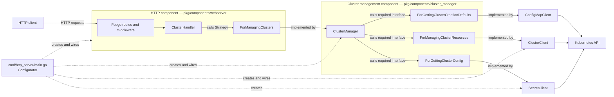

# Architecture

`go-capi-client` is an HTTP component that exposes Cluster API resources from
one Kubernetes namespace. Its design follows Alistair Cockburn's
**Component + Strategy** pattern: the HTTP subsystem declares the service it
requires and receives an implementation of that service when the process
starts.

This document describes the architecture implemented by the current code. It
also calls out places where the implementation is still only a prototype.

## Pattern and terminology

Cockburn describes a component as a bounded, replaceable unit with:

- **provided interfaces**, through which drivers use the component;
- **required interfaces**, which describe the collaborators the component
  needs;
- a **Strategy**, supplied at runtime, that satisfies a required interface;
- a **Configurator**, outside the component, that creates the objects and
  connects them.

`Component` is an architectural role, not a code identifier. Concrete types
are named after the capability they provide, following the existing
`HttpServer` convention: the cluster-management component is therefore named
`ClusterManager`. Constructors and variables follow the same vocabulary
(`NewClusterManager`, `clusterManager`).

Strategies are shared contracts declared under `pkg/strategies/`. Each
contract lives in one `for_*.go` file together with models used only by that
contract. Models shared by multiple Strategies live once in `models.go` so
compatible contracts can exchange values without duplicate representations or
pass-through conversions. Components are declared under `pkg/components/`
and may consume or implement any of these contracts. A concrete component is
injected directly when it satisfies a Strategy; an Adapter is introduced only
when translation is required.

Transport concerns remain inside the transport component. In particular, JSON
metadata and HTTP validation tags belong to DTOs under `components/webserver`;
the shared Strategy models do not contain transport-specific validation.

An Adapter is a particular kind of Strategy: it translates the required
interface and delegates the work to another service. Ports & Adapters is in
turn a specialization of Component + Strategy whose boundary is placed in
front of external technologies.

The primary reference is Alistair Cockburn's
[Component-plus-Strategy generalizes Ports-and-Adapters](https://alistaircockburn.com/Component%20plus%20strategy.pdf),
Humans and Technology Technical Report 2022.01, version 3a (2023-06-01).

## Components and runtime relationships

The roles from Component + Strategy map to the code as follows:

| Pattern role | Implementation | Responsibility |
| --- | --- | --- |
| Driver | HTTP client through Fuego | Sends HTTP requests to the component |
| Provided interface | Routes registered by `HttpServer.Run` | Exposes health and cluster operations over HTTP |
| Component | `pkg/components/webserver` | Owns transport concerns: routing, DTO validation, encoding, middleware, and OpenAPI |
| Strategy | `strategies.ForManagingClusters` | Shared contract used by the HTTP component and implemented by `ClusterManager` |
| Provided operations | `cluster_manager.ClusterManager` methods | Expose cluster-management use cases without declaring a producer-owned Go interface |
| Component | `cluster_manager.ClusterManager` | Owns cluster-management use cases and orchestration |
| Strategies | `ForManagingClusterResources`, `ForGettingClusterConfig` | Describe the capabilities required by `ClusterManager` without Kubernetes types |
| Strategies | `ClusterClient`, `SecretClient` | Implement the component's technology-independent required interfaces using Kubernetes |
| Configurator | `run` and `newK8sClient` in `cmd/http_server/main.go` | Select Kubernetes configuration, instantiate the Strategies and component, and inject the component into `HttpServer.Run` |

Go's implicit interface satisfaction lets `cluster_manager.ClusterManager`
satisfy `ForManagingClusters` directly. The HTTP handler converts its validated
DTOs to and from the transport-neutral Strategy models. `ClusterClient` and
`SecretClient` likewise satisfy their Strategies directly, so no Adapter is
needed in the current graph.

## Request flow

For a typical request such as `GET /api/kubernetes/clusters/{id}`:

1. Fuego matches the route and invokes `ClusterHandler.GetCluster`.
2. The handler extracts the path parameter and calls `ForManagingClusters`.
3. The injected cluster component receives the call directly.
4. The component calls `ForManagingClusterResources`.
5. `ClusterClient`, injected as that Strategy, queries Kubernetes and returns a Strategy model.
6. The handler converts it into an HTTP response DTO and Fuego serializes it.

For creation, `CreateClusterParams` carries the cluster name, control-plane and
worker replica counts, control-plane IP, and VM name prefix through
`ForManagingClusters`. `ClusterManager` enriches this intent through `ForGettingClusterCreationDefaults` with its
VM and bootstrap configuration, Kubernetes version, MachineDeployment identity, endpoint network
settings, and load-balancer choice. It then sends the resulting
`CreateClusterResourceParams` through `ForManagingClusterResources`.

The same dependency path is used for list, delete, and kubeconfig operations.
`/ping` is self-contained in the HTTP component and does not use a Strategy.

## Package boundaries

| Path | Architectural purpose |
| --- | --- |
| `cmd/http_server/` | Executable, CLI options, runtime configuration, and object wiring |
| `pkg/components/webserver/` | HTTP component, transport DTOs, handlers, middleware, and OpenAPI |
| `pkg/components/cluster_manager/` | Cluster-management use cases and orchestration |
| `pkg/components/kubernetes_clients/` | Kubernetes implementations of resource Strategies |
| `pkg/strategies/` | Shared contracts in `for_*.go`; cross-contract models in `models.go` |
| `charts/go-capi-client/`, `k8s/`, `Dockerfile` | Packaging and deployment; they do not contain application behavior |

## Configuration and variability

The configurator currently varies infrastructure configuration rather than the
`ForManagingClusters` implementation:

- `--kube-client=kubeconfig` builds the Kubernetes client from a local file;
- `--kube-client=in-cluster` uses the pod's ServiceAccount configuration;
- `--namespace` scopes all resource clients;
- `--swagger-ui` changes or disables the documentation UI.

`ClusterManager` implements `ForManagingClusters` directly. Its required
Strategies allow Kubernetes clients or test implementations to be injected
without changing the component.

Cluster creation defaults are provided by the
`ForGettingClusterCreationDefaults` Strategy. The `kubernetes_clients.ConfigMapClient`
implements this contract and reads `cluster-defaults` in the configured namespace
on every call. The ConfigMap and the keys documented in the README are required;
missing keys or decoding errors are propagated instead of being replaced by values built
into the binary. The configurator injects this client into `ClusterManager`,
keeping Kubernetes types out of the manager and shared contracts.

`ClusterManager` implements `ForManagingClusters` for the HTTP component
and requires `ForManagingClusterResources`, implemented by `ClusterClient`.
The manager owns the use cases and application error handling; the client
stores each tag as a label on the CAPI `Cluster` with the `tags.vmk.vates.tech/`
prefix. Tags can be supplied during cluster creation or changed through the
HTTP tag routes; the Kubernetes resource is the source of truth across process
restarts. Label-specific validation stays in `ClusterClient`, so another
`ForManagingClusterResources` implementation can apply the constraints of
its own storage technology.

## Current limitations and architectural gaps

- Component and conversion unit tests exist, but the HTTP boundary and the
  Kubernetes Strategies still need integration tests.
- `GetClusterNodesInfo` currently derives its flat node information from CAPI
  Machines. Workload-cluster Node enrichment is not wired yet.
- Authentication middleware currently lets every request through.
- Kubernetes errors pass through without an explicit mapping to HTTP status
  codes.
- The Kubernetes resource clients are Strategies selected by the Configurator.
  The component itself can be isolated through its declared required interfaces.
- The process has one HTTP driver and one Kubernetes-backed strategy. The
  design permits alternatives, but the configurator does not currently select
  among multiple `ForManagingClusters` implementations.

These limitations do not change the dependency direction, but they mean the
component's replaceability and isolation are design properties that still need
to be demonstrated by tests.

### Cluster creation

`ClusterClient` builds cluster resources directly from the request and the
`cluster-defaults` ConfigMap. `ClusterManager` passes network, VM and kubeadm
configuration through `ForGettingClusterCreationDefaults`. No template resources
are read from Kubernetes. The VM/bootstrap YAML blocks are decoded and checked for the expected object shape
before creation, then copied into per-cluster resources owned by the Cluster.
The Cluster stays paused during assembly and is activated after successful
creation. Partial failures can be cleaned up through the delete endpoint.
See README for configuration keys and image prerequisites.
